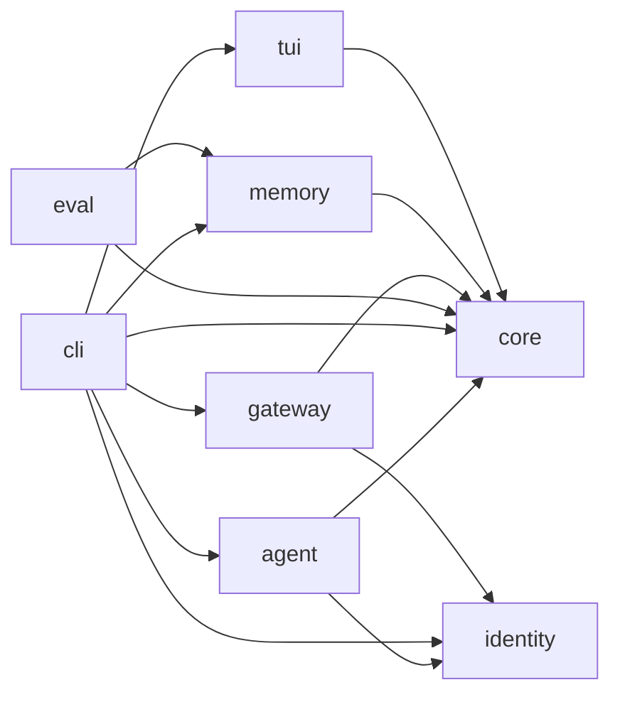

<!--
   -
   - ~xxdorothy/dorothy.git
   - ::: :/docs/wiki/profiles/packages.md
   -
   -->

# Packages

[Wiki home](../../README.md)

Dorothy is eight Bun workspace packages under `packages/`, each named
`@dorothy/<name>`. Bun runs them from source; there is no build. Each
package has its own guide, which is the authority for its files and
invariants. This page says what each is for and which may import which.

The dependency graph is pinned by the `GRAPH` table in
[`workspace.test.ts`](../../../workspace.test.ts), which compares it with
every `package.json`, as it does each package's entry points. A package
exports only the entry points its `package.json` names and imports only
what it declares, as Bun's isolated linker fails an undeclared or internal
import. The same test pins that nothing declares the Claude Agent SDK and
that only `agent` declares the AI SDK's packages. The reasons for the
boundaries are in the
[workspace modularity spec](../../specs/2026-10-09-workspace-modularity-design.md)
and the
[workspace modularity report](../../reports/2026-10-09-workspace-modularity.md);
the wider workflow is under
[repository workflow](../topics/repository-workflow.md).

An arrow below points from a package to one it may import.

`core` and `identity` import no other package. The packages follow in the
order of `GRAPH`.

## agent

Built. Dorothy's model side, and the only package that declares the AI SDK:
the Vercel AI SDK's `ai`, `@ai-sdk/anthropic`, `@ai-sdk/openai-compatible`,
`@openrouter/ai-sdk-provider` and `@ai-sdk/mcp`, each at a thin edge, since
core's contracts carry no SDK type. It runs her chat on one route per role,
reaching Anthropic's Messages API, OpenRouter and Chat Completions servers,
and provides the structured call that reviews and compaction use.

- May import: `core` and `identity`.
- Entry points: one, `"."`.
- Guide:
  [packages/agent/AGENTS.md](../../../packages/agent/AGENTS.md#entry-points-and-imports).

## cli

Built. The `dorothy` program: it is run and not imported, and it wires
every other package together, loading each lazily so that `--help`,
`--list` and `--recall-server` never load the AI SDK. It also holds the
launchers for other hosts, described on the
[harnesses profile](./harnesses.md), and is the one package that declares
Pi, pinned at 1.5.0 (`workspace.test.ts` checks it).

- May import: `agent`, `core`, `gateway`, `identity`, `memory` and `tui`.
- Entry points: none; it exports nothing.
- Guide:
  [packages/cli/AGENTS.md](../../../packages/cli/AGENTS.md#entry-points-and-imports).

## core

Built. The contracts the other packages meet on and the basics they
share: the chat session, the routing contracts, secrets, configuration and
the XDG directories. Contracts are structural and free of SDK types, so
no consumer of a session needs the SDK. It declares one library,
`niceware`, for session phrases.

- May import: no `@dorothy` package and no AI SDK.
- Entry points: one, `"."`.
- Guide:
  [packages/core/AGENTS.md](../../../packages/core/AGENTS.md#entry-points-and-imports).

## eval

Built. The tool that measures Dorothy's memory, for her builders, run as
`bun run eval -- <command>`: a snapshot of a data directory, questions
mined and generated from it, systems asked them, answers judged and a
report. Its design is the
[memory evaluation spec](../../specs/2026-10-18-memory-evaluation-design.md).
Only `snapshot` reads a data directory; every other command works in a
directory it is given. Its libraries are LangChain (`@langchain/core` and
`@langchain/openai`) for the model calls, `openevals` for judging and
`zod` for schemas.

- May import: `core` and `memory`, of memory only
  `@dorothy/memory/evaluation`.
- Entry points: none; nothing imports it.
- Guide:
  [packages/eval/AGENTS.md](../../../packages/eval/AGENTS.md#entry-points-and-imports).

## gateway

Built. A server between an agentic client and the API. It forwards every
request, and in one whose system prompt carries the marker that
`dorothy --claude` appends, it puts Dorothy's identity in the marker's
place. It is additive and learns nothing of memory: the memory block is
opaque text it places as given. The roadmap's
[Dorothy's Gateway](../../roadmap.md#dorothys-gateway) is the idea of
growing it with memory, budgets and model routing, which is not built.

- May import: `core` and `identity`, never the AI SDK.
- Entry points: one, `"."`.
- Guide:
  [packages/gateway/AGENTS.md](../../../packages/gateway/AGENTS.md#entry-points-and-imports).

## identity

Built. Her always-loaded core in `soul.md`, returned by
`identityPrompt()`, and the on-demand `lore`, `voice` and `judgement`
files in `layers/`, returned by `personaLayers()`. The core names no host,
protocol or provider. Chat, the gateway and host delivery all take the
same core; the CLI injects the layers into both memory servers for their
`persona` tool. `personaVersion()` hashes the stripped core and layers,
so a header-only edit leaves it unchanged. The prompt is constant across
calls, preserving its prompt cache
([identity](../topics/identity-and-harnesses.md#one-definition-of-her)).

- May import: nothing, not even `core`; Bun imports its Markdown at module
  load, and calls do no file I/O.
- Entry points: one, `"."`.
- Guide:
  [packages/identity/AGENTS.md](../../../packages/identity/AGENTS.md#entry-points-and-imports).

## memory

Built. Transcripts, notes, facts, projects, recall, compaction, tags and
history, and the service that shares them with other harnesses. It imports
neither the agent nor the AI SDK: reviews and compaction take
core's `StructuredCall`, and prompts arrive as text. The subjects are
listed under [memory](../records.md#memory) in the catalogue of
records. Its libraries are the MCP SDK for the service's tools,
`isomorphic-git` for the history, `yaml` for fact files' front matter,
and `zod` for schemas.

- May import: `core`.
- Entry points: nine. `"."`, `"./bridge"`, `"./claude-hook"`,
  `"./client"`, `"./commands"`, `"./evaluation"`, `"./host-hook"`,
  `"./recall-server"` and `"./service"`. The CLI uses several of them so
  that it loads only what a mode needs.
- Guide:
  [packages/memory/AGENTS.md](../../../packages/memory/AGENTS.md#entry-points-and-imports).

## tui

Built. The Ink chat: its screen, a pure reducer over the chat's state and
a pure input editor. It knows a session only as core's `ChatSession`,
made by the `createSession` it is given, so it needs no SDK types. Its
libraries are Ink and React for the screen, `marked` and `lowlight` for
Markdown and highlighting, and `string-width` for layout.

- May import: `core`.
- Entry points: two, `"."` (`runApp`) and `"./editor"` (`editInEditor`,
  which `--memory` and `--edit-tags` use so that they load no Ink).
- Guide:
  [packages/tui/AGENTS.md](../../../packages/tui/AGENTS.md#entry-points-and-imports).

## Related

- [Repository workflow](../topics/repository-workflow.md)
- [Memory](../topics/memory.md)
- [Models and routing](../topics/models-and-routing.md)
- [Evaluation](../topics/evaluation.md)
- [The terminal](../topics/terminal.md)
- [Identity, harnesses and delivery](../topics/identity-and-harnesses.md)
